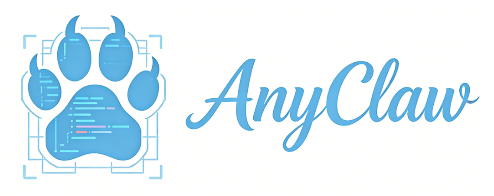

<div align="center">



# AnyClaw Agent框架

**LangGraph headless 内核 + Harness 护栏 + CLI/Web 双端的 Agent 开发底座**

[](https://www.python.org/downloads/)
[](https://github.com/langchain-ai/langgraph)
[](https://www.langchain.com/)
[](https://fastapi.tiangolo.com/)
[](https://react.dev/)
[](https://github.com/wz289494/anyclaw)

</div>

---

## 📖 项目介绍

**AnyClaw** 是一个 Agent 开发底座框架：一个 headless 内核、一套统一事件流、两个前端（CLI 终端 + Web 控制台）。
vibe coding 专属工具，即可改造搭建为自己的通用/垂类 Agent。

### 核心特性

- **LangGraph 显式图内核**：`prepare_context → agent → permission_gate → tools` 循环，checkpoint 持久化，进程重启可恢复会话
- **Harness 护栏**：Always/Ask/Never 三级权限 + 参数模式规则 + pre/post hooks + JSONL 审计——工具级强制，不是 prompt 级请求
- **CLI/Web 双端**：`anyclaw` 终端交互，`anyclaw web` 浏览器控制台，共用同一内核与事件 schema，会话互通
- **人工确认（HITL）**：ask 级工具触发 `interrupt()` 挂起，CLI Confirm / Web 弹窗确认后 `resume` 继续
- **MCP 接入**：config/mcp.yaml 声明外部 MCP server，工具并入同一权限管控；server 挂掉不影响启动
- **多模型支持**：OpenAI、Gemini、Qwen、DeepSeek、Kimi（OpenAI 兼容接口）
- **记忆体系**：STM（checkpoint + JSON 投影）/ LTM（相关度检索）/ Profile 层 / Skills 自动激活 / 历史压缩
- **任务隔离**：每会话独立 sandbox 目录；文件工具写操作默认仅限沙箱
- **可验证**：pytest 内核测试（fake model，无需 API key）+ eval 场景 + 第二 AI 评审

### 架构

```
                 ┌────────────────────────────────────────────────────────┐
                 │                    core/ (headless)                    │
  cli/ ──────────┤  AgentKernel.astream / resume                          │
  (Rich 渲染器)   │    └─ LangGraph StateGraph + AsyncSqliteSaver          │
                 │         prepare_context → agent → route                │
  server/ ───────┤              ↑              ├─ 无 tool_calls → END     │
  (FastAPI+SSE)  │              │              └─ permission_gate         │
       │         │              │                   ├─ never → 拦截       │
       ▼         │              │                   ├─ ask → interrupt()  │
  web/ (React)   │              └── tools ←─────────┴─ always → 放行      │
                 │  harness: permissions / hooks / audit                  │
                 │  checkpoint = 真相源 → STM JSON 投影（单写者）           │
                 └────────────────────────────────────────────────────────┘
   tools/ (@tool 自动发现) + MCP tools (langchain-mcp-adapters)
```

---

## 🚀 快速部署

### 1. 环境要求

- Python 3.10+
- Node.js 18+（仅 Web 前端开发/构建需要）

### 2. 安装

```bash
git clone https://github.com/wz289494/anyclaw.git
cd anyclaw

# 项目虚拟环境（隔离依赖，不污染全局 Python）
python3 -m venv .venv
source .venv/bin/activate        # Windows: .venv\Scripts\activate

# 安装（按需选择 extras）
pip install -e ".[dev,web,mcp,gemini]"
# 最小 CLI：pip install -e .
```

> 国内网络可加镜像：`pip install -i https://pypi.tuna.tsinghua.edu.cn/simple -e ".[dev,web,mcp,gemini]"`

### 3. 配置 API Key

```bash
cp .env.example .env
# 编辑 .env，填入你的 API Key（变量名约定 *_APIKEY）
```

### 4. 配置模型

编辑 `config/model.yaml`（按场景配置不同模型）：

```yaml
main:                  # ReAct Agent 底座
  provider: deepseek   # openai / gemini / qwen / deepseek / kimi
  model: deepseek-chat
  api_key_env: DEEPSEEK_APIKEY

text_generation:       # 文本生成 / 历史压缩摘要 / eval 评审
  provider: qwen
  model: qwen-plus
  api_key_env: QWEN_APIKEY

element_extraction:
  provider: qwen
  model: qwen-plus
  api_key_env: QWEN_APIKEY

code_generation:
  provider: deepseek
  model: deepseek-chat
  api_key_env: DEEPSEEK_APIKEY
```

### 5. 运行

```bash
# CLI 终端
anyclaw

# Web 控制台（浏览器打开 http://127.0.0.1:8000）
anyclaw web --port 8000
```

Web 前端开发模式（热更新）：

```bash
cd web && npm install && npm run dev   # http://localhost:5173，代理 /api → 8000
# 生产构建：npm run build → web/dist，由 FastAPI 单端口服务
```

---

## 💡 使用

### CLI 命令

| 命令 | 说明 |
|------|------|
| `/new` | 新建会话（独立 task_id + sandbox） |
| `/memory` | 查看并恢复历史会话（checkpoint 恢复，跨进程重启） |
| `/models` `/tools` `/profile` `/skills` | 查看各层状态（支持 `reload`） |
| `/skills match <query>` | 预览技能自动激活 |
| `/clear` | 清除 STM/checkpoint/审计/sandbox（需确认） |
| `/exit` | 退出会话 / 程序 |

### Web 控制台

- 会话侧栏：新建 / 切换 / 删除，与 CLI 会话互通
- 流式对话：token 级渲染 + Markdown
- 工具调用卡片：参数 / 结果 / 状态 / 耗时
- **权限弹窗**：ask 级工具挂起等待确认（允许 / 拒绝 / 本会话始终允许）；刷新页面自动恢复 pending 确认
- 状态面板：工具（含 MCP server 状态）/ 模型 / Profile / Skills，支持热重载
- Token 用量实时显示

---

## 🛡️ Harness 配置

### 权限策略 `config/permissions.yaml`

```yaml
default_tier: ask          # always（放行）/ ask（确认）/ never（拦截）

tools:                     # 工具级（支持 glob，如 weather_*）
  demo_calculator: always
  read_file: always
  write_file: ask
  run_shell: ask

rules:                     # 参数模式规则（命中即生效，优先于工具级）
  - tool: run_shell
    pattern: 'rm\s+-rf|sudo\s|mkfs|shutdown|reboot'
    action: never
    reason: 危险命令

mcp:
  default_tier: ask        # MCP 工具默认 ask
  servers: {}              # 按 server 覆盖（工具名前缀 = server 名）

path_scope:                # 路径护栏额外根（默认写仅限 sandbox/{task_id}）
  write_roots: []
  read_roots: []
```

评估顺序：参数规则 → 会话 allowlist → 工具级 → MCP server 级 → 默认。
"本会话始终允许"仅会话级生效（checkpoint 持久化），不回写配置文件。

### Hooks `config/hooks.yaml`

```yaml
auto_discover: true        # 自动发现 hooks/*.py 的 pre_tool_use / post_tool_use
hooks: []                  # 或显式列出 callable（dotted path）
```

pre-hook 可 block/修改参数（异常 fail-closed）；post-hook 可修改结果。

### 审计

每次工具决策与结果摘要写入 `memory/audit/{日期}.jsonl`（决策 / 来源 / 耗时 / 结果摘要）。

### MCP `config/mcp.yaml`

```yaml
enabled: true
tool_name_prefix: true     # 工具名加 server 前缀，避免重名
servers:
  math:
    transport: stdio
    command: python
    args: ["./mcp_servers/math_server.py"]
  weather:
    transport: streamable_http
    url: http://localhost:8000/mcp
```

MCP 工具与本地工具走同一权限/hooks/审计；单个 server 挂掉只记状态跳过。

---

## 🔧 Vibe coding 继续开发

### 1. 添加新工具（作者体验不变）

在 `tools/` 下新建 Python 文件，用 `@tool` 装饰器，返回 JSON 字符串：

```python
from langchain_core.tools import tool
from utils.task_context import get_task_id
from utils.path import ensure_task_dirs

@tool
def my_tool(query: str) -> str:
    """
    描述：……
    使用时机：……
    输入：query（必填）……
    输出：JSON 字符串，含 ok / result 字段。
    """
    task_id = get_task_id()
    # 文件产出请写入 sandbox/{task_id}（参考 tools/fs.py 的路径护栏）
    return '{"ok": true, "result": "..."}'
```

自动发现注册（`config/tools.yaml` 控制启停），`/tools reload` 或 Web 面板热重载。
在 `config/permissions.yaml` 给它配权限等级。

### 2. 定制 Agent 人格与行为

- `prompt/system_prompt.txt`：基础 system prompt
- `IDENTITY.md` / `SOUL.md` / `AGENT.md` / `USER.md` / `MEMORY.md` / `TOOLS.md`：Profile 层（编辑后下一轮即生效）
- `skills/*.md` + `config/skills.yaml`：技能库（关键词自动激活）

### 3. 换 Logo / 名称 / 欢迎语

- Logo：`docs/logo图/logo图.png`
- CLI 图标与欢迎语：`cli/display.py` 的 `print_icon()` / `print_welcome()`
- 项目名：`pyproject.toml`、`cli/main.py`、`web/index.html`、README

---

## 🧪 测试与 Eval

```bash
# 内核测试（fake model，无需 API key）
pytest

# Eval 场景（CI 模式 / 真实模型 / 第二 AI 评审）
python evals/runner.py
python evals/runner.py --real --judge
```

覆盖：图循环与事件顺序、ask/never 权限与 interrupt/resume、审计去重、
checkpoint 跨进程恢复、压缩配对、投影 schema、ContextVar 传播、
路径护栏（.. / 符号链接逃逸）、MCP 加载与容错、Web SSE 与权限流。

---

## 📁 项目架构

```
anyclaw/
├── core/               # headless 内核
│   ├── events.py       # 统一事件 schema（CLI/Web 共用）
│   ├── state.py        # AgentState（LangGraph 图状态）
│   ├── graph.py        # 显式图：context→agent→permission_gate→tools
│   ├── kernel.py       # AgentKernel facade（astream/resume/投影/LTM）
│   ├── projection.py   # STM JSON 投影（单写者）
│   └── harness/        # permissions / hooks / audit
├── cli/                # CLI 薄渲染器 + 主菜单
├── server/             # FastAPI 服务端（SSE / 会话 / 状态路由）
├── web/                # React + Vite 前端控制台
├── tools/              # @tool 工具（自动发现）：calculator/fs/search/shell
├── model/              # 模型工厂（多 provider）
├── utils/              # 会话/记忆/技能/profile/路径护栏/MCP 注册
├── config/             # model/tools/skills/profile/prompt/kernel/permissions/hooks/mcp
├── prompt/             # system prompt 文本
├── skills/             # 技能库（Markdown）
├── evals/              # 场景化 eval + 第二 AI 评审
├── tests/              # pytest 内核测试
├── memory/             # STM 投影 / LTM / checkpoint / 审计（运行时生成）
├── sandbox/            # 任务沙箱（运行时生成）
├── IDENTITY.md SOUL.md AGENT.md USER.md MEMORY.md TOOLS.md  # Profile 层
└── scripts/            # 工具冒烟脚本
```

---

## 📝 许可证

本项目采用 **NON-COMMERCIAL LEARNING LICENSE 1.1**（非商业学习许可证）。

Copyright (c) 2024 relakkes@gmail.com

本软件及其相关文档文件（以下简称"软件"）在以下条件下授权使用：

#### 授权范围

版权所有者授予任何接受本许可证的自然人或法人实体（以下简称"用户"）免费、非独占、不可转让的权利，以非商业学习为目的使用、复制、修改和合并本软件。

#### 使用条件

1. 用户必须在软件及其副本的所有合理显著位置包含上述版权声明和本许可证声明
2. 软件仅限于学习和研究目的，不得用于大规模爬取或干扰平台运营的活动
3. 未经版权所有者书面同意，软件不得用于任何商业目的或对第三方造成不当影响

#### 免责声明

1. 软件按"现状"提供，不提供任何明示或暗示的保证，包括但不限于适销性、特定用途适用性和非侵权性的保证
2. 在任何情况下，版权所有者均不对因使用本软件或无法使用本软件而产生的任何直接、间接、偶然、特殊、示范性或后果性损害承担责任

#### 完整许可证

完整的许可证文本请查看 [LICENSE.txt](LICENSE.txt) 文件。

**注意**：如需商业使用，请联系版权所有者获取商业许可。

---

## 🤝 贡献

欢迎提交 Issue 和 Pull Request！

---

<div align="center">

**Made with ❤️ by AnyClaw Team**

</div>